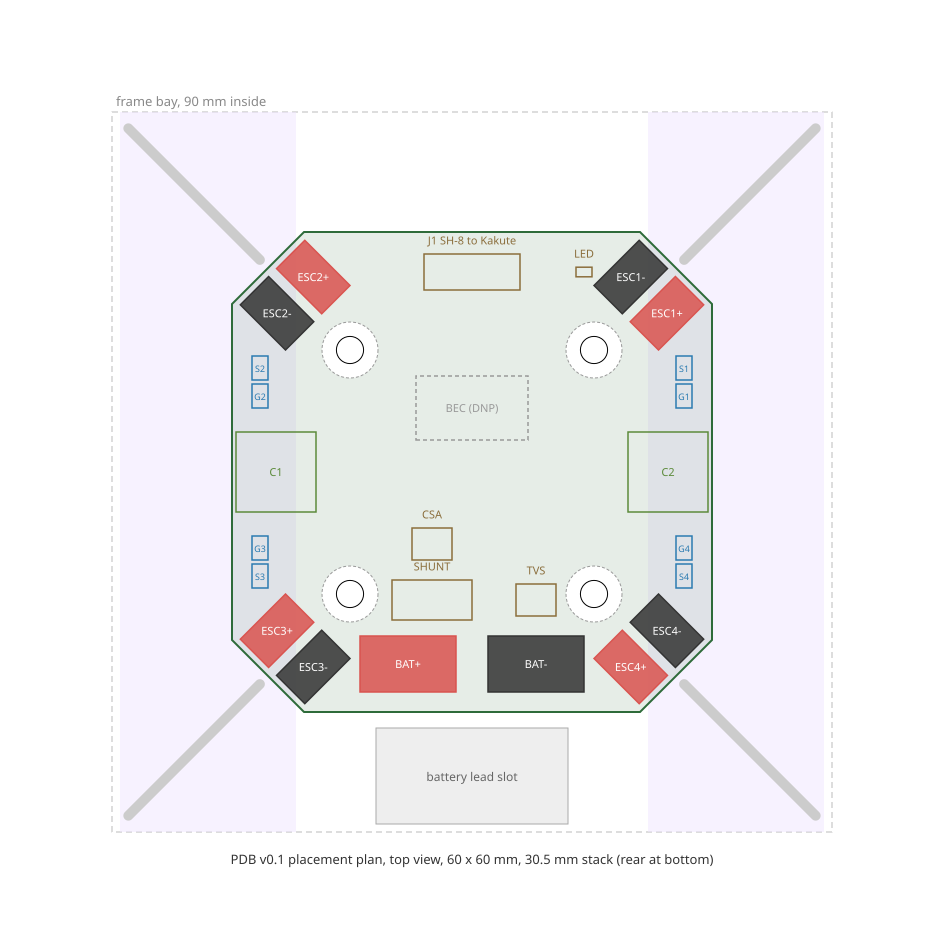

# Custom power distribution board (PDB), v0.2 design

A single board that replaces the current two-board power setup (the 150 A 6-port XT60 board feeding the ESCs, plus
the old 25 A board feeding the Kakute). It also adds two regulated supplies and current/voltage logging.
This folder is self-contained: nothing in `frame/`, `feed/` or the top-level docs depends on it or is changed by it.

Status: **requirements, sizing and placement plan.** No schematic or PCB yet. Next step: the KiCad project
(see [Next steps](#next-steps)).

Figures marked *(verify)* are from memory or are design estimates. Check them against the datasheet or the real part
before ordering boards.

| File | What it is |
|---|---|
| `params.py` | Every design input, each tagged with where it came from |
| `calc.py` | Sizes copper, shunt, supplies, wires and connectors → `out/calc.json`, [`out/CALC.md`](out/CALC.md) |
| `layout.py` | Board outline and placement plan → [`out/layout.svg`](out/layout.svg), `out/outline.dxf` (KiCad Edge.Cuts) |

```bash
cd pdb && python3 calc.py && python3 layout.py
```

No packages needed beyond Python 3.

### What changed from v0.1

| | v0.1 | v0.2 |
|---|---|---|
| Continuous / 10 s peak | 60 A / 100 A | **100 A / 150 A** |
| Battery lead | XT60, 12 AWG | **XT90, 8 AWG** |
| ESC leads | 16 AWG | 14 AWG |
| Shunt / ArduPilot scale | 0.5 mΩ / 40 A/V | 0.25 mΩ / 80 A/V |
| Supplies | none (Kakute BECs only) | **BEC1 5 V / 3 A for a flight controller, BEC2 12 V or 5 V / 3 A for other equipment** |
| Logging | analog current to the Kakute | **analog current + voltage, plus an INA228 digital power monitor on I2C** |
| Board | 60 mm | 66 mm |

**100 A is about twice what this drone can draw today.** Full throttle on all four motors is ~50 A, and the 30 A ESCs
cap each branch. The extra rating is headroom for bigger motors and ESCs later.

---

## Requirements

| # | Requirement | Value | Why |
|---|---|---|---|
| R1 | Input | 6S LiPo, 25.2 V max, XT90 on an 8 AWG pigtail | Your choice of connector |
| R2 | Parts on the battery bus | rated ≥ 35 V; capacitors 50 V; converters 60 V input | ESC switching spikes ride on top of 25.2 V |
| R3 | Continuous current | **100 A** | |
| R4 | Peak current | **150 A for 10 s** | Copper must survive it |
| R5 | ESC outputs | 4 solder pad pairs, 14 AWG, one per arm, on the corners | 25–30 A per branch at the full rating |
| R6 | Flight-controller supply | **BEC1: 5 V / 3 A**, on J2 (Pixhawk-style power port) and on solder pads | Powers a Pixhawk-class FC directly, or the Kakute's peripherals |
| R7 | Auxiliary supply | **BEC2: 12 V / 3 A, solder jumper to 5 V**, on solder pads | VTX, cameras, LEDs, other equipment |
| R8 | Current and voltage data | Analog to the FC **and** digital (I2C) | Live readings, ArduPilot logs, and logging from a companion computer |
| R9 | Kakute link | J1: JST-SH 8-pin carrying VBAT, GND, CURR and M1–M4 | Same as a 4-in-1 ESC: one plug |
| R10 | ESC signals | 4 signal + ground pad pairs, routed to J1 | The OPTO ESCs need only signal and ground |
| R11 | Mounting | 30.5 × 30.5 mm M3 pattern, 66 mm square | Uses the bay's existing standoffs; 12 mm per side for wires |
| R12 | Protection | TVS across the bus, 4 × bulk capacitors, power LED | |

Not in scope for v0.2: an antispark or electronic switch, and reverse-polarity protection on the main bus
(impractical at 100 A without large MOSFETs; the XT90 is keyed).

## Block diagram

```
                       +------------------------------- PDB ---------------------------------------+
 XT90 --8 AWG-->  BAT+ |--[ 0.25 mΩ Kelvin shunt ]--+== VBAT bus (L1 + L3) ==+--> ESC1+ .. ESC4+    |
                       |       |            |       |                        +--> C1a..C2b, TVS, LED |
                       |  [INA240A2]    [INA228]    +--> BEC1 buck --> 5 V  --> J2 pins 1-2, 5V pads |
                       |   gain 50     I2C power    +--> BEC2 buck --> 12/5 V --> AUX pads           |
                       |       |        monitor     +--> 3.3 V LDO --> INA240                        |
                       |       |            |       +--> 11:1 divider --> VOLT                       |
                       |     CURR ------------------------------------------> J1 (Kakute), J2        |
                       |                    +-- SCL/SDA -----------------------> J3 (I2C)            |
                 BAT-  |== GND bus (L2 + L4) ==========================> ESC1- .. ESC4-             |
                       |  S1..S4, G1..G4 (ESC signals) ---> J1 JST-SH 8 ---> Kakute                  |
                       +-----------------------------------------------------------------------------+
```

The shunt is on the **high side** (in the + lead), so the ground plane stays one solid piece. The INA240 and INA228
are both specified for high-side sensing at these voltages *(verify: I recall −4 to 80 V for the INA240 and
0–85 V for the INA228)*. Both read the same shunt through its Kelvin pins.

## Current and voltage data

| Path | Measures | Read by | Notes |
|---|---|---|---|
| **Analog** (INA240 → CURR on J1 and J2; divider → VOLT on J2) | Current, voltage | Flight controller ADC | ArduPilot logs them (`BAT` messages: voltage, current, mAh, Wh, as I recall) and streams them over the ELRS MAVLink link to Mission Planner |
| **Digital** (INA228 → J3, I2C address 0x40) | Bus voltage, current, power, energy, charge, die temperature | FC I2C bus, or a companion computer (phase 2) | 20-bit; the board accumulates energy and charge itself, so readings survive a slow reader |

Setup in ArduPilot:
- Analog monitor (Kakute via J1): `BATT_MONITOR = 4`, `BATT_AMP_PERVLT = 80`, `BATT_AMP_OFFSET = 0`.
  The Kakute reads voltage on its own VBAT input. Calibrate both against a meter and a clamp meter.
- Analog monitor (Pixhawk-class FC via J2): add `BATT_VOLT_MULT = 11`.
- Digital monitor as a second battery: ArduPilot has an INA2xx battery-monitor driver. **I'm not certain it supports
  the INA228 in your firmware version, or which `BATT2_MONITOR` value selects it.** Check the ArduPilot battery-monitor
  docs before relying on it. A companion computer can always read the INA228 directly (Linux has drivers for the INA2xx family).

The INA228's widest range gives 655 A full scale on this shunt (1.25 mA per step). Its narrower ±40.96 mV range gives
about 164 A full scale. That still covers the 150 A peak, with finer steps. Pick the range in software.

## Supplies

| Rail | Output | Use | Heat at full load | Notes |
|---|---|---|---|---|
| BEC1 FC | 5 V / 3 A | J2 Pixhawk-style power port (pins 1–2), and 5V/G pads | ~1.7 W | Fixed 5 V |
| BEC2 AUX | 12 V / 3 A (or 5 V via jumper) | AUX/G pads | ~4 W | Jumper on the feedback divider; default 12 V |

- Both are the same 60 V-input buck converter, with a 5 A switch, 1.7× the 3 A load. A TI TPS54560-class part is
  my suggestion *(verify ratings and pick a current part)*.
- **The Kakute still powers itself from VBAT on J1** (its input is 7–42 V, with its own 5 V and 9 V BECs). Use BEC1
  to take the GPS, receiver and buzzer off the Kakute's 5 V rail if you want. **Don't connect BEC1 to the Kakute's 5 V
  pads without checking Holybro's docs:** two supplies on one rail can fight.
- Both converters sit between the stack holes, under the Kakute. **The stack spacer must clear the tallest inductor
  (likely 5–7 mm).**
- At full load the converters add ~5.7 W of heat on a small board. Real loads will be much lower; check it on the bench.

## Sizing results

Full output: [`out/CALC.md`](out/CALC.md). Headlines:

| Item | Result |
|---|---|
| Stack-up | 4 layers, 2 oz on every layer. L1 VBAT, L2 GND, L3 VBAT, L4 GND. Each net has whole layers to itself |
| Main bus width needed (IPC-2221) | 32.5 mm at 100 A / +20 °C; **34.8 mm at 150 A / +45 °C**. About 46 mm available (+32 %) |
| Stack-up options | 2 oz / 1 oz inner also fits (42 mm). 3 oz outer or 6 layers fit easily |
| Each ESC branch | ≥ 6.2 mm at 30 A |
| Power-path loss | ~6.2 W at 100 A (3.7 W copper, 2.5 W shunt); 1.6 W at today's full throttle; ~0.05 W at hover |
| Shunt | 0.25 mΩ; 2.5 W at 100 A, 5.6 W at the 150 A peak → **choose a part rated ≥ 6 W** |
| Analog current full scale | **256 A** at the 3.3 V ADC, 0.064 A per step |
| 8 AWG battery pigtail (120 mm) | ~5 W at 100 A |

IPC-2221 is the older, conservative method; IPC-2152 usually allows narrower copper. Treat these widths as a floor.

### XT90 and 100 A (read this)

As I recall, Amass rates the XT90 at about **45 A continuous and 90 A burst** *(verify on Amass's datasheet; hobby
sellers often quote 90 A continuous)*. On that rating:
- Today's drone is fine: ~9 A at hover, and ~50 A full throttle in bursts.
- **100 A held continuously is over the XT90's rating.** If you later fly near 100 A for minutes, use an AS150 or
  8 mm bullets. The board pads take any 8 AWG lead, so it's only a pigtail swap.

## Placement plan



- Battery pads on the rear edge, above the frame's battery lead slot (the board edge covers 1 mm of the slot, 8 mm higher up).
- Shunt right after BAT+, with the INA240, INA228 (PMON), 3.3 V LDO and TVS beside it.
- ESC pad pairs on the four chamfered corners, each facing its arm. **+ and − swap sides from corner to corner**
  (the pattern is mirrored), so the silkscreen must mark each pad clearly.
- 4 bulk capacitors and the ESC signal pads on the side strips, outside the Kakute's footprint.
- BEC1 and BEC2 in the clear cross between the stack holes.
- Front edge: J1 (Kakute), J2 (FC power port), and a row with the 5V/G pads, J3 (I2C) and the AUX/G pads.
- Copper-free rings (7 mm) round the stack holes, so a metal screw or washer can't short VBAT to GND.

## Parts (first pass)

| Ref | Part | Notes |
|---|---|---|
| R1 | 0.25 mΩ 4-terminal current-sense shunt, ≥ 6 W | Metal-strip Kelvin shunt *(pick a real part; check its derating)* |
| U1 | TI INA240A2 (gain 50) | Analog current; run at 3.3 V so its output can't exceed the ADC range *(verify)* |
| U2 | 3.3 V LDO, ≥ 40 V input | e.g. TI LM2936-3.3 or a TPS7A16-class part *(verify)* |
| U3 | TI INA228 | Digital power monitor on I2C *(verify ratings)* |
| U4, U5 | 60 V-input 5 A buck converter + inductor, diode, caps | BEC1 and BEC2; e.g. TPS54560-class *(verify)* |
| R2, R3 | 100 kΩ / 10 kΩ 1 % divider | VOLT for J2 |
| D1 | SMDJ28A-class TVS | Off below 28 V, clamps near 45 V *(verify)* |
| C1a–C2b | 4 × 470 µF 50 V low-ESR electrolytic, 10 × 10 mm SMD | The ESCs have their own caps too |
| D2, R4 | Power LED + resistor | |
| J1 | JST-SH 8-pin to the Kakute ESC connector | Pin order not confirmed |
| J2 | JST-GH 6-pin Pixhawk-style power port | 5V, 5V, CURR, VOLT, GND, GND *(as I recall the standard; verify)* |
| J3 | JST-GH 4-pin I2C | 5V, SCL, SDA, GND *(verify against the FC's I2C port)* |
| — | XT90 on 8 AWG; 14 AWG to the ESCs | Frame wire grooves (12 × 7 mm) were sized for 16 AWG; 2 × 14 AWG should still fit *(verify)* |

## Things to verify before the schematic

1. **Kakute H7 v1.5 ESC connector pin order** and which edge it's on. `params.py` has a placeholder order.
2. Kakute current input: confirm it's a 3.3 V ADC and which `BATT_CURR_PIN` it uses.
3. Whether the Kakute's 5 V rail tolerates an external 5 V (only matters if you want BEC1 to feed it).
4. ArduPilot INA228 support and its `BATT2_MONITOR` value, and the FC's I2C connector pin order.
5. Real ratings for the shunt, converters, TVS, LDO, INA parts and capacitors you pick.
6. XT90 datasheet rating.
7. Your PCB fab's 4-layer copper options (the 2 oz / 1 oz case still fits, with less margin).

## Bench test plan (once boards arrive)

1. Bare board: VBAT-to-GND and each rail-to-GND must read open, not a short.
2. Bench supply at 25 V, current limit 0.5 A: LED on; LDO 3.3 V; BEC1 5 V; BEC2 12 V (then 5 V with the jumper); CURR ~0 V.
3. Load each rail to 3 A with an electronic load; check the output voltage and the converter temperature.
4. Read the INA228 over I2C (from a laptop with a USB-I2C adapter, or the FC). Check voltage against a meter.
5. Pass a known current and check CURR and the INA228 against a clamp meter; tune `BATT_AMP_PERVLT`.
6. Full drone, props off: ArduPilot shows voltage and current, and the log has them.
7. Props on, tethered: short full-throttle bursts; check hot spots with a thermometer.

## Next steps

1. Confirm the Kakute pinout and the items above.
2. Create the KiCad project in `pdb/kicad/`: schematic first, then import `out/outline.dxf` as Edge.Cuts.
3. Lay out the board following the placement plan; fill planes per the stack-up; stitch GND pads with via arrays.
4. DRC, then a design review before ordering.
